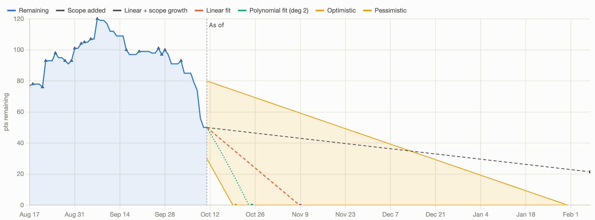

# Jira Release Projection

Drop in a Jira CSV export for a fix version and see when the release is likely to finish. Everything runs in your browser; the file is never uploaded.

<picture>
  <source media="(prefers-color-scheme: dark)" srcset="docs/burndown-dark.png">
  
</picture>

## Quick start

Open `index.html`, or serve the folder:

```bash
python3 -m http.server 8000
```

Drop a CSV on the page, or click **Try sample data**.

## Getting the CSV

In Jira, search `fixVersion = "Your Version"`, then **Export → Export CSV (all fields)**.

The "current fields" export works too, but it has no completion date unless you add the **Resolved** column first. Without that column, the page uses each ticket's last-updated date instead.

Estimates come from **Story Points** or **Original estimate** (converted to days), or you can just count tickets.

## What you get

- **Projected finish dates** from linear and polynomial regression, average velocity, ticket rate, optimistic/pessimistic bounds and a Monte Carlo simulation (P50/P85/P95).
- **Burn-up or burn-down chart.** It picks the burn-up when scope changed a lot during the release.
- **Target date check.** Pick a ship date to see the chance of hitting it, the weekly pace it needs, and how much to cut to be 85% confident.
- **Partial credit for work in progress.** Count tickets in Code Review, Test and other in-progress statuses as partly done.
- **Forecast history.** The finish date the page would have projected at the end of each past week, so you can see whether the date is holding or slipping.
- **Data-quality checks.** Flags tracking tickets counted as work, unestimated or oversized tickets, unassigned or stale work and similar problems, with one-click fixes where possible.
- **Velocity chart.** Total or by issue type, per week or per 2 weeks.
- **Ticket completion chart.** Created vs completed, or net.
- **Chance-of-finishing curve** from the Monte Carlo simulation.
- **Remaining work by assignee,** including who is the bottleneck.
- **Remaining tickets table.** All tables are sortable.
- **Backtesting.** Set **As of** to a past date to see what the projection said then.
- **Sharing.** Copy a summary for Slack, download charts as PNG, or export a PDF of the expanded sections.

**How Each Projection Works**, at the bottom of the page, explains each method. In brief:
- **Bounds** move each remaining story-point estimate one Fibonacci step (5 → 3 or 8) and pair it with the fastest or slowest recent velocity.
- **Resolutions:** tickets closed as anything other than delivered work (for example "No Action") are removed from scope. You can change which resolutions count.

## Tests

```bash
node test/projection.test.js [path/to/export.csv]
```
